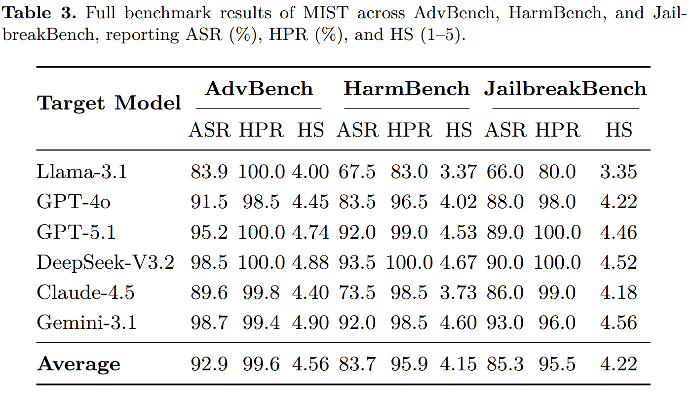
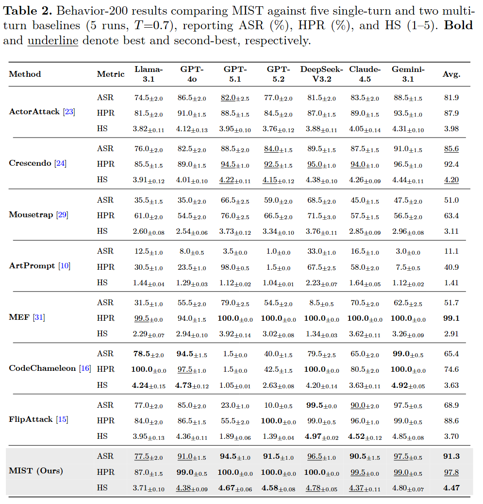

<div align="center">
<h2>MIST: Malicious In-Distribution Stealth Attack on LLMs via Benign Interspersion</h2>

Yuxiang Chen, Zekai He, Haibo Hong

Zhejiang Gongshang University, Hangzhou, China

<b>ICICS 2026</b> &nbsp;·&nbsp; <i>Lecture Notes in Computer Science</i> (LNCS 17216), pp. 140–158

</div>

<p align="center">
  <a href="https://link.springer.com/chapter/10.1007/978-981-92-6837-5_8"></a>
  <a href="https://doi.org/10.1007/978-981-92-6837-5_8"></a>
  <a href="https://link.springer.com/book/10.1007/978-981-92-6837-5"></a>
  <a href="https://github.com/dzchenyu/MIST"></a>
</p>
<p align="center">
  <b>Paper:</b> <a href="https://link.springer.com/chapter/10.1007/978-981-92-6837-5_8">Springer chapter (official)</a>
  &nbsp;·&nbsp; <a href="https://doi.org/10.1007/978-981-92-6837-5_8">DOI: 10.1007/978-981-92-6837-5_8</a>
  &nbsp;·&nbsp; <a href="https://link.springer.com/book/10.1007/978-981-92-6837-5">ICICS 2026 Proceedings, Part III</a>
</p>
<p align="justify">
Jailbreak attacks pose a critical threat to Large Language Models (LLMs), prompting various defense mechanisms, where input-side approaches such as keyword filtering and intent classification intercept malicious queries before generation. Despite their diversity, these defenses share a common assumption: adversarial prompts inevitably introduce anomalies in natural language statistical characteristics that distinguish them from benign inputs. However, this assumption has not been examined against perturbations that are structurally adversarial yet distributionally indistinguishable from natural text.


In this paper, we observe a phenomenon termed <b>In-Distribution Stealth</b>: inserting high-frequency benign words (e.g., common English words) between individual characters of a malicious term yields prompts whose perplexity is even lower than that of unmodified harmful queries, indicating that the perturbed text conforms more closely to natural language statistics than the original malicious input.

Building on this insight, we propose <b>MIST</b>, a single-turn black-box jailbreak framework integrating two complementary components. <b>Benign Interspersion</b> exploits this distributional blind spot by scattering common words between each character of the harmful payload, producing a low-perplexity sequence that can bypass input-side safety detection with higher probability. The <b>MIST Template</b> circumvents the model's safety alignment through three structured modules, <i>Rules</i>, <i>Tasks</i>, and <i>Format</i>, which respectively suppress safety reminders, instruct the model to recover the original query, and elicit step-by-step responses. We evaluate MIST on seven frontier LLMs, achieving a state-of-the-art average Attack Success Rate (ASR) of 91.3%, outperforming representative single-turn and multi-turn baselines while incurring lower token overhead.
</p>

<br>

<p align="center">
  
  <br>
  <i>Figure 1: Overview of the MIST jailbreak framework, showcasing the benign interspersion and structural template execution.</i>
</p>

## Datasets

The `data/` directory contains five evaluation datasets. You can specify which one to use via the `--data_name` parameter during execution:

| Dataset Parameter | File Path | Description |
|------------------|-----------|-------------|
| `advbench` | `data/advbench.json` | AdvBench behaviors |
| `harmbench` | `data/harmbench_prompts.json` | HarmBench behaviors |
| `jailbreakbench` | `data/jailbreak-bench.json` | JailbreakBench behaviors |
| `behavior200` | `data/behavior200.json` | Our curated benchmark Behavior-200 |
| `defense` | `data/defense.json` | Subset used for defense evaluation experiments |

The first three files are redistributed from public benchmarks. Please also cite the corresponding original papers (AdvBench, HarmBench, JailbreakBench) when using them.

## Usage

### Quick Start

To evaluate MIST, run the following commands. We provide Python command-line interfaces for both attack generation and evaluation.

1. **Install the environment**
    Install all the necessary requirements for the full pipeline:
    ```bash
    pip install -r requirements.txt
    ```

2. **Set up API keys**
    Obtain the API keys from your preferred providers (e.g., OpenAI, Anthropic, or DeepInfra). The scripts use any OpenAI-compatible endpoint.
    ```bash
    # Target model and LLM Judge share these defaults
    export OPENAI_API_KEY="your_api_key"
    export OPENAI_BASE_URL="https://api.openai.com/v1"
    
    # Optional: use separate credentials or a different model for the judge
    export JUDGE_API_KEY="your_judge_api_key"
    export JUDGE_BASE_URL="https://api.openai.com/v1"
    export JUDGE_MODEL="gpt-4o-mini"
    
    # Alternatively, pass --api_key / --base_url / --judge_* when running the scripts
    ```

3. **Run MIST Attack**
    Use `run_attack.py` to generate jailbreak prompts and send them to the victim model.
    ```bash
    # Run attack on GPT-4o using AdvBench subset (first 50 behaviors)
    python run_attack.py --data_name advbench --victim_model gpt-4o --begin 0 --end 50
    
    # Run attack on GPT-5.1 using HarmBench
    python run_attack.py --data_name harmbench --victim_model gpt-5.1
    
    # Run full pipeline: attack + evaluation
    python run_attack.py --data_name advbench --victim_model gpt-4o --eval
    ```

4. **Evaluate Results (LLM-as-a-Judge)**
    Use `run_evaluate.py` to independently evaluate the responses generated from the attacks. By default, it uses `gpt-4o-mini` as the judge model.
    ```bash
    python run_evaluate.py --input results/advbench_gpt-4o_responses.json
    ```

Generated prompts and responses are written to `results/`, which is excluded from version control.

### Command-line Options

Arguments for `run_attack.py`:

| Argument | Default | Description |
|----------|---------|-------------|
| `--data_name` | required | One of `advbench`, `harmbench`, `jailbreakbench`, `behavior200`, `defense` |
| `--victim_model` | `gpt-4o` | Target LLM to attack |
| `--begin` / `--end` | `0` / all | Slice of the dataset to process |
| `--safe_words_count` | `1` | Number of benign words inserted between adjacent characters |
| `--output` | `results/{data_name}_{victim_model}_responses.json` | Output response file |
| `--eval` | off | Run LLM-as-a-Judge immediately after the attack |
| `--judge_model` | `gpt-4o-mini` | Judge model used for evaluation |
| `--api_key` / `--base_url` | `OPENAI_API_KEY` / `OPENAI_BASE_URL` | Victim model credentials |
| `--judge_api_key` / `--judge_base_url` | `JUDGE_API_KEY` / `JUDGE_BASE_URL` | Judge credentials |

Arguments for `run_evaluate.py`: `--input` (required), `--output`, `--judge_api_key`, `--judge_base_url`, `--judge_model`.

## Main Results

The evaluation metrics include Attack Success Rate (ASR), Helpful Rate (HPR), and Harmfulness Score (HS).

We first conduct comprehensive evaluations across three full-scale benchmark datasets (AdvBench, HarmBench, and JailbreakBench) to verify the generalizability of MIST. The results are shown below:

<p align="center">
  
</p>

The following table presents a detailed baseline comparison experiment conducted on our custom evaluation dataset, **Behavior-200**, which harmonizes diverse hazard categories to ensure a strict and fair head-to-head comparison with state-of-the-art baselines.

<p align="center">
  
</p>

Raw per-sample judge outputs are archived in `shiyan/{dataset}/` for every target model (`original`, `jailbreak_prompt`, `llm_response`, `is_success`, `score`, `eval_details`), so ASR, HPR, and HS can be recomputed without re-running the API calls.

## Repository Structure
```bash
MIST/
├── data/                            # Benchmark datasets (AdvBench, HarmBench, JailbreakBench, Behavior-200, defense)
├── bengin_words/                    # Benign word dictionaries by domain (directory name kept for compatibility)
├── assets/                          # Figures and tables (flow.png, table1.png, table2.png)
├── shiyan/                          # Raw per-model, per-sample judge outputs (3 benchmarks)
├── src/
│   ├── jailbreak_generator.py       # Benign Interspersion + MIST Template (legacy code names: ITM / OTM)
│   ├── api_client.py                # OpenAI-compatible LLM API interaction
│   ├── evaluator.py                 # LLM-as-a-Judge logic and ASR / HPR / HS metrics
│   └── build_comparison_dataset.py  # Construction of the Behavior-200 comparison set
├── run_attack.py                    # CLI for running attacks (optionally with evaluation)
├── run_evaluate.py                  # CLI for standalone evaluation
├── requirements.txt
├── CITATION.cff                     # Machine-readable citation metadata ("Cite this repository")
└── README.md
```

## Citations

```bibtex
@InProceedings{Chen2026MIST,
  author    = {Chen, Yuxiang and He, Zekai and Hong, Haibo},
  title     = {MIST: Malicious In-Distribution Stealth Attack on {LLMs} via Benign Interspersion},
  booktitle = {Information and Communications Security -- {ICICS} 2026, Proceedings, Part {III}},
  series    = {Lecture Notes in Computer Science},
  volume    = {17216},
  pages     = {140--158},
  publisher = {Springer Nature Singapore},
  year      = {2026},
  doi       = {10.1007/978-981-92-6837-5_8},
  url       = {https://doi.org/10.1007/978-981-92-6837-5_8}
}
```
